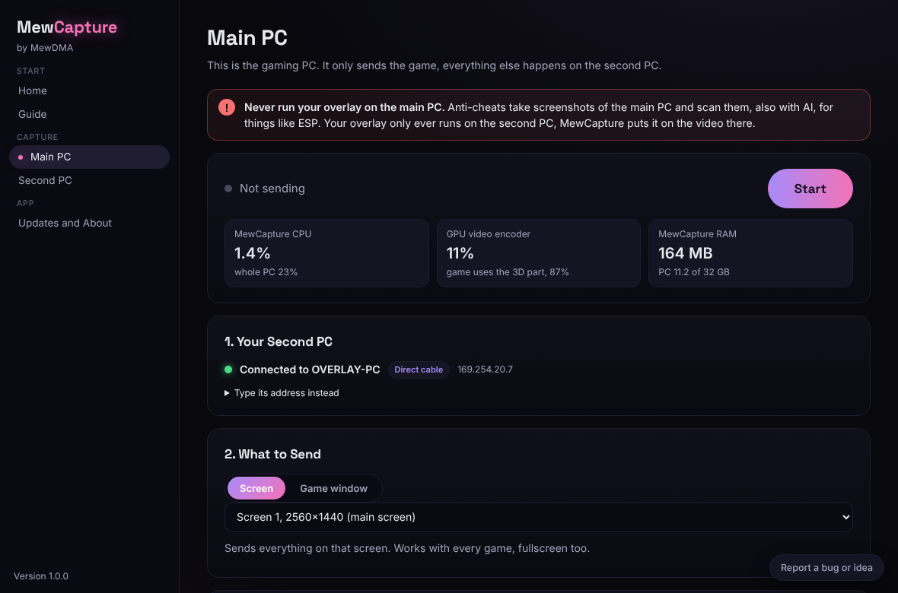
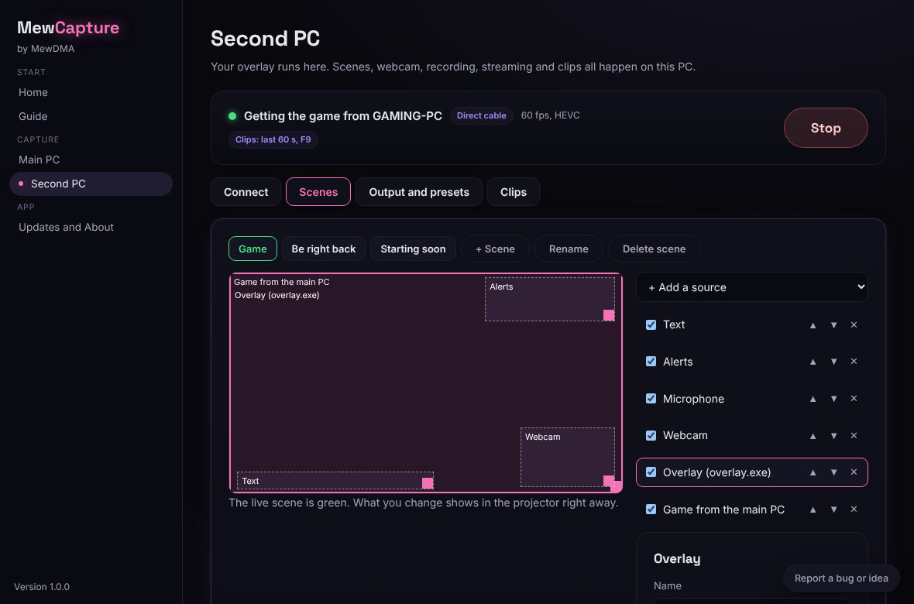
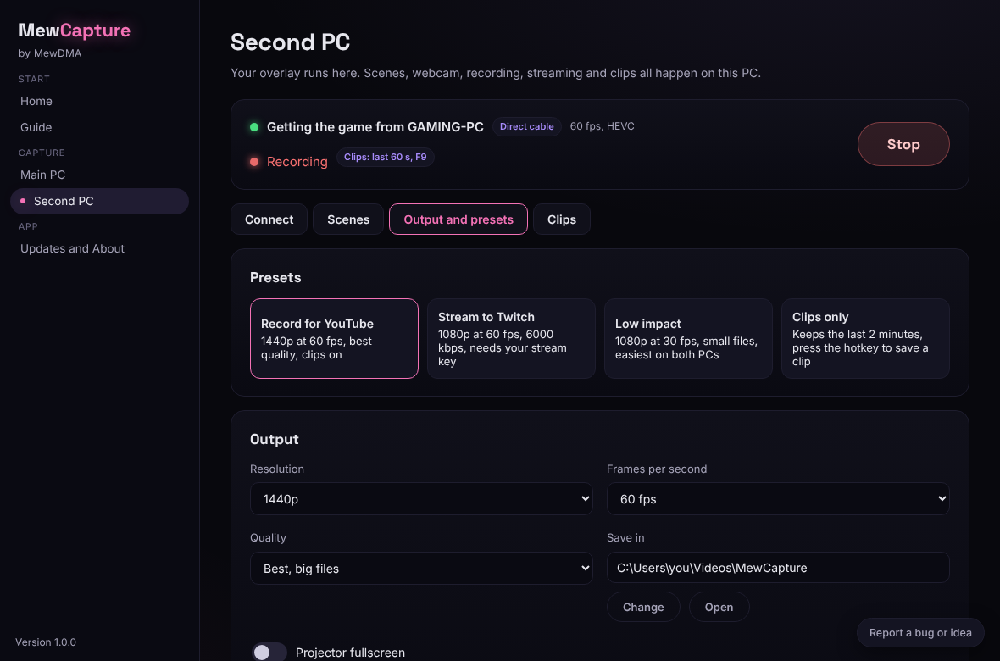
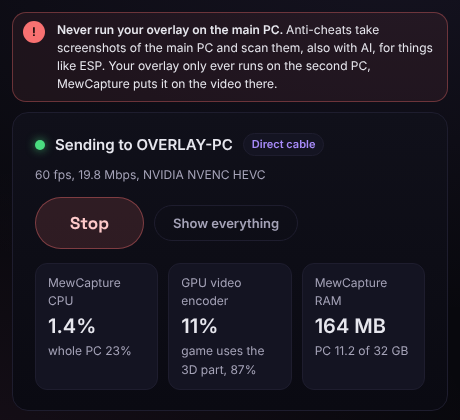

**Free Windows app to record or stream your game with your overlay on it, no capture card needed.** 
Made by <a href="https://mewdma.net">MewDMA</a> for DMA setups with a main PC and a second PC.

---

> [!WARNING]
> **Never run your overlay on the main PC.** Anti-cheats take screenshots of the main PC and scan them, also with AI, for things like ESP. Your overlay only ever runs on the second PC, MewCapture puts it on the video there.

## What it does

<table>
<tr>
<td width="50%" valign="top">

**No capture card** 
The main PC sends the game to the second PC over your home network or one Ethernet cable, up to 4K or 144 fps

</td>
<td width="50%" valign="top">

**Barely costs fps** 
Straight from the screen into your graphics card's video encoder (NVENC, AMF or QuickSync), HEVC when both PCs can, low priority, no preview. The app shows exactly how little it uses

</td>
</tr>
<tr>
<td valign="top">

**Overlay on top, safely** 
Pick your overlay window on the second PC and its background gets removed by itself. MewCapture warns you if an overlay shows up on the main PC

</td>
<td valign="top">

**Scenes like OBS, but simple** 
Game, overlay, webcam, mic, images, text and browser sources. Drag and resize, switch scenes, set volumes

</td>
</tr>
<tr>
<td valign="top">

**Record, stream or clip** 
Presets for YouTube, Twitch, Low impact and Clips only. Clip That saves the last 30 seconds to 2 minutes with one hotkey on either PC

</td>
<td valign="top">

**Ready for OBS too** 
A clean projector window you add in OBS as a Window Capture

</td>
</tr>
<tr>
<td valign="top">

**Pairs by itself** 
The second PC shows Found with the main PC's name, both show the same code, press Connect once and they reconnect by themselves

</td>
<td valign="top">

**Direct cable** 
One Ethernet cable between the two PCs is found and used by itself, your internet stays as it is

</td>
</tr>
</table>

## Install

1. Download the installer from <a href="https://github.com/MewDMA/MewCapture/releases/latest">releases</a> and install it on **both** PCs
2. Run it. Windows might say "Windows protected your PC", click More info then Run anyway. That's just because the app isn't code signed yet
3. Open MewCapture, it asks for admin so it can open the firewall for the other PC

## Setup in 5 steps

1. **Second PC:** open MewCapture, pick **Second PC** and press **Start**
2. **Main PC:** open MewCapture and pick **Main PC**. Your second PC shows up with a 4-digit code
3. **Second PC:** it shows **Found: your main PC**. Check the code matches and press **Connect**. That's only needed once
4. **Main PC:** pick your screen or game window, tick the apps you want to hear and press **Start**
5. **Second PC:** in **Scenes**, add your overlay window, then pick a preset and press **Record** or **Go live**, or capture **MewCapture Projector** in OBS

The full guide with a picture for every step is in the app under **Guide**, and on <a href="https://mewdma.net/guides">mewdma.net/guides</a>.

## Screenshots

<table>
<tr>
<td width="50%"></td>
<td width="50%"></td>
</tr>
<tr>
<td align="center">Main PC: pick what to send and press Start</td>
<td align="center">Second PC: scenes with your overlay, webcam and more</td>
</tr>
<tr>
<td></td>
<td align="center"></td>
</tr>
<tr>
<td align="center">Presets, recording and streaming</td>
<td align="center">The main PC's small window shows how light it is</td>
</tr>
</table>

## FAQ

**Can I run my overlay on the main PC?** 
No, never. Anti-cheats screenshot the main PC and scan it, also with AI, for things like ESP. The overlay only runs on the second PC. MewCapture warns you in red if it sees one on the main PC.

**Do I need a capture card?** 
No. The game goes over your network or a direct cable instead.

**What's the best connection?** 
One normal Ethernet cable straight from the main PC to the second PC. MewCapture finds it by itself and your internet keeps going through your other port or Wi-Fi. No spare Ethernet port? A USB to Ethernet adapter works, plug it into the PC that needs the extra port, usually the second PC. Next best is both PCs on the router with cables. Wi-Fi works too.

**Does it cost fps on the main PC?** 
Very little. It goes straight into your graphics card's video encoder, which is separate from the part that runs your game, at low priority and with no preview. The Main PC screen shows its CPU, GPU and RAM use live.

**Is it safe with anti-cheat?** 
MewCapture only captures the screen, the same way Discord streaming does (Windows Graphics Capture or DXGI desktop duplication). It never injects into or hooks the game, never puts a DLL in it and never reads its memory. Your overlay must never be shown on the main PC.

**How do I use it with OBS?** 
Add a Window Capture of **MewCapture Projector**. For sound, pick **For OBS** under Game Sound in MewCapture, then add an Application Audio Capture of the same window. You can keep your speakers silent. Or skip OBS and use MewCapture's own Record and Go live.

**The PCs can't find each other** 
Press Start on the second PC first and put both on the same router, not a guest network. Some routers keep devices apart (AP or client isolation), and VPNs can hide your home network. MewCapture tells you what it finds, with a Fix button when it can fix it. A direct cable always works.

**The game is black or nothing shows** 
Pick Screen instead of Game window. Game window capture needs the game in borderless or windowed mode.

**Parts of my overlay disappear, or there's a dark border** 
Move the How much gets removed slider. If your overlay lets you pick its background color, pick pure green and press Detect background.

**What does it need?** 
64 bit Windows 10 version 2004 or newer, or Windows 11, on both PCs.

## Report a bug

Click **Report a bug or idea** at the bottom left of the app. It goes straight to us, no account needed, and you can see exactly what gets sent before you send it.

---

**Need help?** Ask on the <a href="https://mewdma.net/forum">forum</a> or open a ticket in our <a href="https://discord.gg/mewdma">Discord</a>.

MewCapture uses <a href="https://ffmpeg.org">FFmpeg</a> under the LGPL 2.1.

<!-- mewcapture-guides -->
## Guides

Our step by step guide with a picture for every step is in the app under **Guide**, and on <a href="https://mewdma.net/guides">mewdma.net/guides</a>:

- Setting up both PCs and pairing them
- The overlay safety rule: never on the main PC
- Direct cable between the two PCs, and USB to Ethernet adapters
- Scenes, webcam, mic, text and browser sources
- Presets, recording, streaming to Twitch and Clip That
- Game sound into recordings, or for OBS
- When the PCs can't find each other
