

<a href="https://mewdma.net/capture">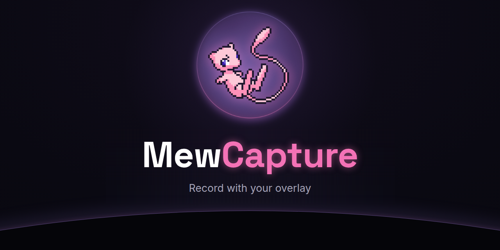</a>

# MewCapture, the free recording and streaming app for two-PC DMA setups

MewCapture is a free Windows app made by [MewDMA](https://mewdma.net) that records or streams your game with your overlay on it, without a capture card. You install it on both PCs of your DMA setup, and the main PC sends the game and the sound you pick to the second PC over your own network or one Ethernet cable. The second PC adds your overlay, scenes and webcam, then records, goes live on Twitch, YouTube and Kick or saves clips, and you can [download the latest version here](https://github.com/MewDMA/MewCapture/releases/latest).

<b>Windows 10 and 11, 64 bit</b> &nbsp;·&nbsp; <b>Free</b> &nbsp;·&nbsp; <b>Up to 4K or 144 fps</b> &nbsp;·&nbsp; <b>Updates itself</b>

<a href="#download-and-install-mewcapture">Download</a> &nbsp;|&nbsp;
<a href="#mewcapture-features">Features</a> &nbsp;|&nbsp;
<a href="#how-mewcapture-works">How it works</a> &nbsp;|&nbsp;
<a href="#how-mewcapture-compares">Compare</a> &nbsp;|&nbsp;
<a href="#mewcapture-screenshots">Screenshots</a> &nbsp;|&nbsp;
<a href="#what-you-need">Requirements</a> &nbsp;|&nbsp;
<a href="#safety-and-anti-cheat">Safety</a> &nbsp;|&nbsp;
<a href="#mewcapture-faq">FAQ</a> &nbsp;|&nbsp;
<a href="#guides-and-support">Guides</a>

## Download and install MewCapture

1. Grab `MewCapture-Setup-<version>.exe` from the [latest release](https://github.com/MewDMA/MewCapture/releases/latest). It's a normal Windows installer, and the `MewCapture-Update` file next to it is only there for automatic updates.
2. Run it on both PCs, your main PC (the one you game on) and your second PC (the one your overlay runs on).
3. Open MewCapture and say yes when it asks for admin, because it adds the Windows Firewall rules that let the other PC reach it. Pick Main PC or Second PC and the Start Guide walks you through the rest and picks good settings for you.

> [!IMPORTANT]
> Your overlay, recording and streaming all go on the second PC, and the main PC just sends the game and the sound you pick. MewCapture warns you in red if the second PC's output ever comes back to the main PC.

> [!NOTE]
> If Windows says "Windows protected your PC", click **More info** and then **Run anyway**. That shows up because the installer isn't code signed yet.

> [!TIP]
> Every release has a `SHA256SUMS.txt` if you want to check the file. Run `Get-FileHash` on the installer in PowerShell and compare the hash with the one in that file.

## MewCapture features

<table>
<tr>
<td width="50%" valign="top">

### 🎥 Record your overlay with no capture card

The main PC sends the game to the second PC over your own network or one Ethernet cable, at up to 4K or 144 fps.

</td>
<td width="50%" valign="top">

### ⚡ Light on the main PC

The game goes directly from the screen into your graphics card's video encoder at low priority, and the Main PC screen shows how little it uses.

</td>
</tr>
<tr>
<td width="50%" valign="top">

### 🧩 Your overlay with its background removed

Pick your overlay window on the second PC and MewCapture removes its background for you, with a live preview and a slider.

</td>
<td width="50%" valign="top">

### 🎬 Scenes and webcam

Add your webcam with its background blurred or removed, images, text, countdowns, browser sources and a keys and mouse display, with studio mode and a cut, fade or move between scenes.

</td>
</tr>
<tr>
<td width="50%" valign="top">

### 🔴 Record and go live

Presets for YouTube, Twitch, Low impact and Clips only, and you can go live on Twitch, YouTube and Kick at the same time with the chat in the app.

</td>
<td width="50%" valign="top">

### ✂️ Clip That

A hotkey on either PC saves the last 30 seconds to 2 minutes with the overlay or clean, and you can trim it and send it to the main PC.

</td>
</tr>
<tr>
<td width="50%" valign="top">

### 🎚️ Mixer with separate tracks

Meters, mute and rename for every source, and any source can get its own track in the recording and its own audio file for editing.

</td>
<td width="50%" valign="top">

### 🔗 Pair with a 4-digit code

Press Connect on both PCs when they show the same code, and after that they find each other and connect by themselves.

</td>
</tr>
<tr>
<td width="50%" valign="top">

### 📺 Works with OBS

Set up OBS for me gives OBS on the second PC a MewCapture scene collection with the projector and its sound.

</td>
<td width="50%" valign="top">

### 🛠️ Something's Wrong

Checks both PCs and the link between them, fixes things like the firewall for you and makes a summary for your ticket.

</td>
</tr>
</table>

<b>See every MewCapture feature in detail</b>

#### Main PC: send the game and the sound

| Part | What it does |
|---|---|
| What to send | Whole screen works with every game, fullscreen too. One window sends just the game's window and needs the game in borderless or windowed mode, and Sound only sends the sound with no picture. |
| Sound | Tick the apps you want to hear, like the game and Discord, or turn on All PC sound. Each app goes in a sound category like Game, Communication or Music, which is its own source in the second PC's mixer, and Send my mic too sends your main PC mic along. |
| Encoder | NVIDIA NVENC, AMD AMF or Intel QuickSync at low priority, with the CPU as the backup. It sends HEVC when both PCs' graphics cards can handle it and H.264 when they can't. |
| Quality | Smooth (12 Mbps, best for Wi-Fi), Balanced (20 Mbps), Sharp (35 Mbps) or Max (50 Mbps, cable only), at 30, 60, 120 or 144 fps. Test the connection picks the quality for you in about 6 seconds. |
| Light | The Main PC screen shows how much CPU, video encoder and RAM MewCapture uses, with no preview so it stays light. Close the window and it keeps running in the tray. |
| Start from the second PC | After the first time you can also start sending from the second PC, as long as MewCapture is open on both. |

#### Second PC: your overlay

| Part | What it does |
|---|---|
| Overlay tab | Your overlay has its own tab on the Second PC screen. Pick your overlay window shows your open windows with a picture of each, and you pick the one your overlay shows in. |
| Background removal | MewCapture finds the overlay's background (usually black) and how much to remove, and the live preview shows it over the game. |
| How much gets removed | A slider for when parts of the overlay disappear or a dark border shows, and Detect again finds the background color and how much to remove for you. If your overlay lets you pick its background color, pure green works best. |
| Per game | MewCapture remembers your overlay settings for each game and brings them back when that game runs again. |

#### Second PC: scenes and webcam

| Part | What it does |
|---|---|
| Sources | The game, your overlay, a webcam, images, text, a countdown or timer, browser sources for alerts, the MewDMA background and a keys and mouse display. |
| Webcam | Blur it blurs the room behind you and Remove it takes it away, with no green screen needed. |
| Editing | The stage and your sources sit side by side and each box on the stage shows what's in it. Boxes snap to the guides, arrow keys move them a bit, Ctrl+Z undoes and right-click has more. |
| Studio mode | Lets you change the next scene while the live one stays as it is, then switch with a cut, a fade or a move where the sources slide to their new spot. Scene hotkeys work from both PCs. |

#### Second PC: sound

| Part | What it does |
|---|---|
| Mixer | Meters, volume, mute and rename for every source. |
| Tracks | Each source is In the mix or Own track and file, which keeps it apart in the recording and also saves it as its own audio file next to it, ready for editing. |
| Add a source | Adds the sound of any app on the second PC. |
| Hear it on this PC | Plays the sound from the main PC on the second PC with the volumes and mutes you set, Sound only too. |

#### Second PC: record, stream and clip

| Part | What it does |
|---|---|
| Presets | Record for YouTube (1440p at 60 fps, best quality), Stream to Twitch (1080p at 60 fps, 6000 kbps), Low impact (1080p at 30 fps, small files) and Clips only (keeps the last 2 minutes). |
| Output | 720p, 1080p, 1440p or 4K at 30, 60, 120 or 144 fps, and it shows how many Mbps and GB per hour that adds up to. Start recording and Go live are on the Second PC status card too. |
| Recording | MP4 files, encoded in AV1, HEVC or H.264 on the second PC's graphics card with the CPU as the backup. Recordings are never overwritten, a setting you change while recording carries on in a new file, and Sound only recordings save as .m4a. You can also save the game and the webcam as their own video files. |
| Streaming | Go live on Twitch, YouTube and Kick at the same time with your own stream keys, and a stream that drops connects again by itself. When you record and stream at different settings, the recording uses its own encoder and bitrate. |
| Chat | Your Twitch, YouTube and Kick chat in one tab, which can also pop out into its own window or dock to the side. |
| Clip That | A hotkey on either PC saves the last 30 seconds, 1 minute, 90 seconds or 2 minutes, with the overlay or clean (just the game). Trim it before you save it, and Send to main PC copies it to Videos\MewCapture\Clips on the main PC. |
| Hotkeys | Only keys that can't steal a key from your game, like F keys, the numpad or combos with Ctrl, Alt or Win, and never Windows shortcuts like Alt+Tab or Ctrl+C. |
| OBS | Set up OBS for me adds a MewCapture scene collection with the projector and its sound and never changes your other scene collections. You can also add the projector to OBS yourself with Using OBS. |

#### Pairing, network and help

| Part | What it does |
|---|---|
| Pairing | Press Connect on both PCs when they show the same 4-digit code. After that the two PCs sign what they send each other and connect by themselves as soon as both are open. Either PC can forget the other with Forget. |
| Network | Same router over Wi-Fi, Ethernet or both, or one Ethernet cable directly between the PCs, and it shows Direct cable when it uses one. Type the address yourself is there for when the PCs can't find each other. |
| Ports | UDP 47800 to find each other, UDP 47801 for the game and TCP 47802 for clips, and MewCapture adds the Windows Firewall rules for you. |
| Something's Wrong | Checks this PC, the other PC and the link between them, with Fix it buttons for things like the firewall and a summary for your ticket that has no PC name, user name or stream keys in it. |
| Error codes | Every error in the app has a short MC code with the cause and the fix. |
| Updates | Signed updates from the MewDMA/MewCapture releases, checked when the app starts and once a day. An update never installs in the middle of sending, a recording or a stream. |

## How MewCapture works

MewCapture splits the work between your two PCs. Your main PC captures the screen or the game window with Windows Graphics Capture or DXGI desktop duplication, the same way Discord streaming does, and hands it directly to your graphics card's video encoder at low priority. It sends the picture and the sound you pick to your second PC over your own network or one Ethernet cable.

Everything else happens on your second PC, where MewCapture removes your overlay's background and puts the overlay on the game, adds your scenes and webcam, and records, streams or saves clips. If you'd rather use OBS, MewCapture feeds OBS on the second PC through its projector window.

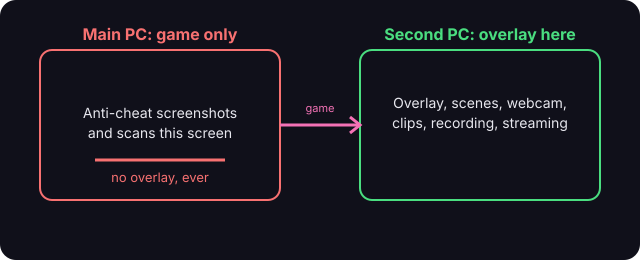

### How to record your overlay with MewCapture

1. Install MewCapture on both PCs and pick Main PC or Second PC on each.
2. On the second PC, press Start receiving, then press Pick your overlay window in the Overlay tab and pick the window your overlay shows in.
3. On the main PC, find your second PC on the Main PC screen. When both PCs show the same 4-digit code, press Connect on the second PC and then on the main PC.
4. On the main PC, pick Whole screen, One window or Sound only, tick the apps you want to hear like the game and Discord, and press Start sending.
5. On the second PC, set up Scenes and Audio, pick a preset in Output and press Start recording or Go live.

Every step with pictures is in [docs/guide.md](docs/guide.md) and in [How to set up MewCapture on both PCs](https://mewdma.net/guides/set-up-mewcapture).

## How MewCapture compares

Every option here can get your overlay into a recording, and the difference is the cost, the setup and what runs on your main PC. Prices and numbers are the makers' own, checked in October 2026.

| | Cost | Extra hardware | Setup | Records and streams by itself |
|---|---|---|---|---|
| **MewCapture** | Free | None, just a cable or a USB to Ethernet adapter if you want a direct link | Install on both PCs, match a 4-digit code and pick your overlay window | Yes, it records, streams to Twitch, YouTube and Kick at once and saves clips with Clip That |
| **OBS + NDI** | Free, since OBS, the DistroAV plugin and NDI Tools cost nothing | None, wired gigabit is best for full NDI | OBS and DistroAV on both PCs, then key out the overlay's black and line up the delay by hand | Yes, OBS records and streams |
| **Sunshine + Moonlight** | Free and open source | None | Sunshine on the main PC, Moonlight on the second, pair with a PIN, then OBS on the second PC for the overlay | No, you add OBS on the second PC |
| **Parsec** | Free for personal use, and Warp, which adds 4:4:4 color, is $9.99 a month | None | A Parsec account and the app on both PCs, then OBS on the second PC for the overlay | No, you add OBS on the second PC |
| **Capture card** | About $140 to $180 for a card with passthrough, like the Elgato HD60 X | The capture card and another HDMI cable, after your fuser | Wire the card after your fuser with passthrough to your monitor and USB to the second PC, then OBS | No, you add OBS or the card maker's app |

| | Delay | Quality | What runs on the main PC |
|---|---|---|---|
| **MewCapture** | A small network delay, we haven't published a measured number yet | Up to 4K or 144 fps, encoded on your graphics card, and it lowers the quality by itself when packets drop | Only Windows screen capture with nothing injected into the game. The overlay never runs there, and you get a red warning if the second PC's picture comes back |
| **OBS + NDI** | Low on a wired network | Full NDI is close to lossless but needs about 125 Mbps at 1080p60, and NDI HX uses far less and is compressed | Fine if your overlay stays on the second PC. OBS's Game Capture hooks into the game and Display Capture doesn't, and nothing warns you if it's set up wrong |
| **Sunshine + Moonlight** | Low on a wired network, it's made for playing games over it | Up to 4K with HDR and up to 120 fps, encoded on your graphics card | Fine if your overlay stays on the second PC. Sunshine captures the desktop without a game hook, and nothing warns you if it's set up wrong |
| **Parsec** | Low on a wired network, it's made for playing games over it | Up to 4K at 60 fps, or up to 240 fps at lower resolutions, and 4:4:4 color needs Warp | Fine if your overlay stays on the second PC. Parsec captures the desktop without a game hook, and nothing warns you if it's set up wrong |
| **Capture card** | None on the passthrough, and the capture runs under 100 ms behind (Elgato's figure) | Depends on the card, the HD60 X captures up to 1080p60 or 4K30 | Nothing extra runs on the main PC at all, your fuser mixes in the overlay after it |

If you'd rather go another way, [Record or stream your DMA overlay with OBS](https://mewdma.net/guides/record-or-stream-without-a-capture-card) and [Record or stream your DMA overlay with a capture card](https://mewdma.net/guides/record-or-stream-with-the-overlay) have the steps.

## MewCapture screenshots

<table>
<tr>
<td width="50%" valign="top" align="center">Main PC sending the game 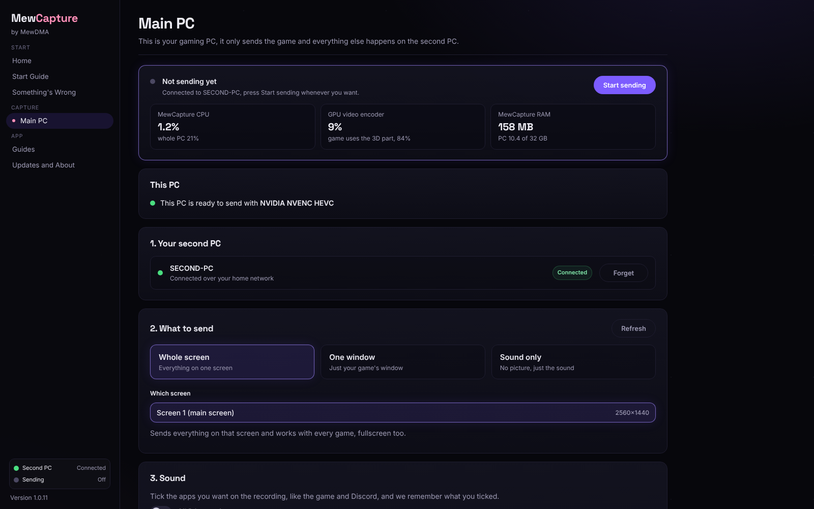</td>
<td width="50%" valign="top" align="center">Second PC getting the game 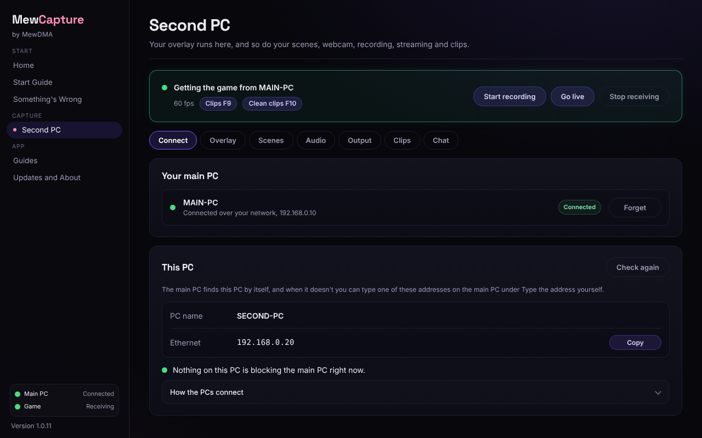</td>
</tr>
<tr>
<td width="50%" valign="top" align="center">Pairing with a 4-digit code 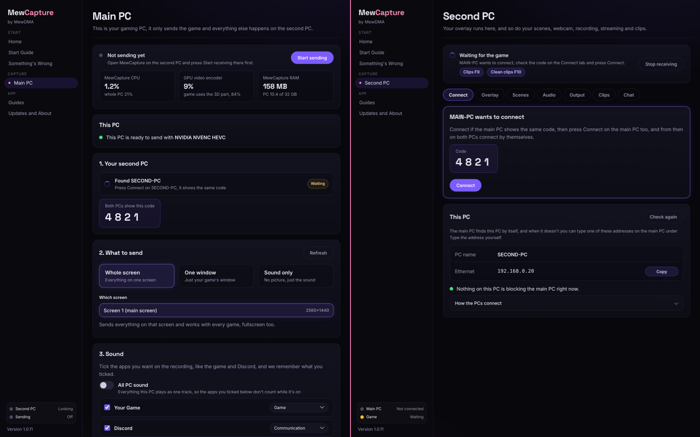</td>
<td width="50%" valign="top" align="center">Your overlay 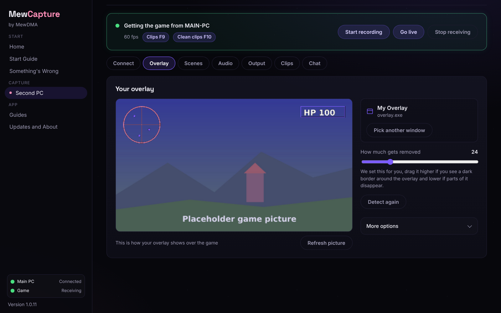</td>
</tr>
<tr>
<td width="50%" valign="top" align="center">Scenes 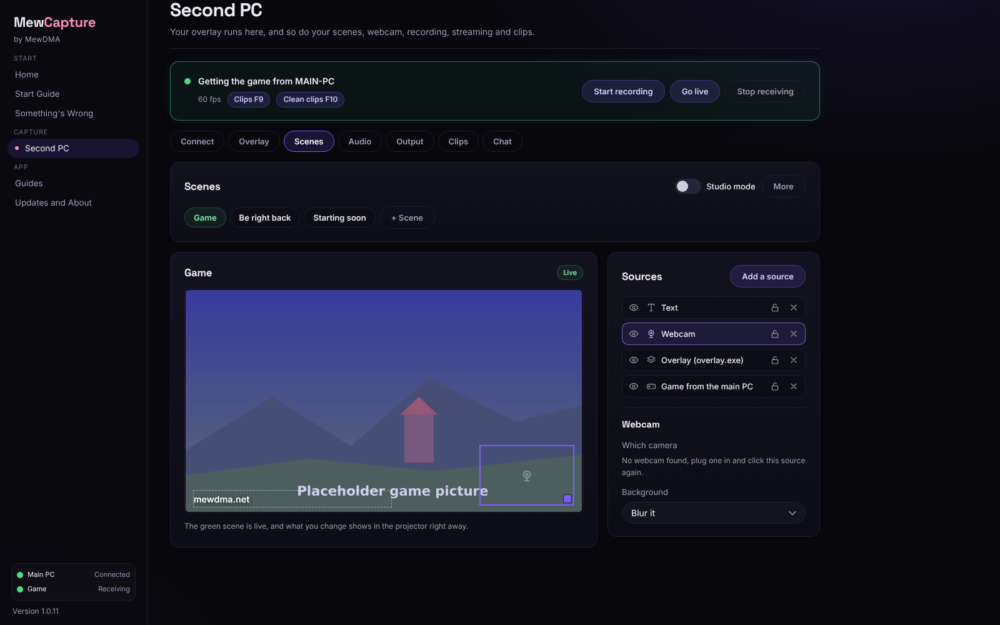</td>
<td width="50%" valign="top" align="center">Mixer 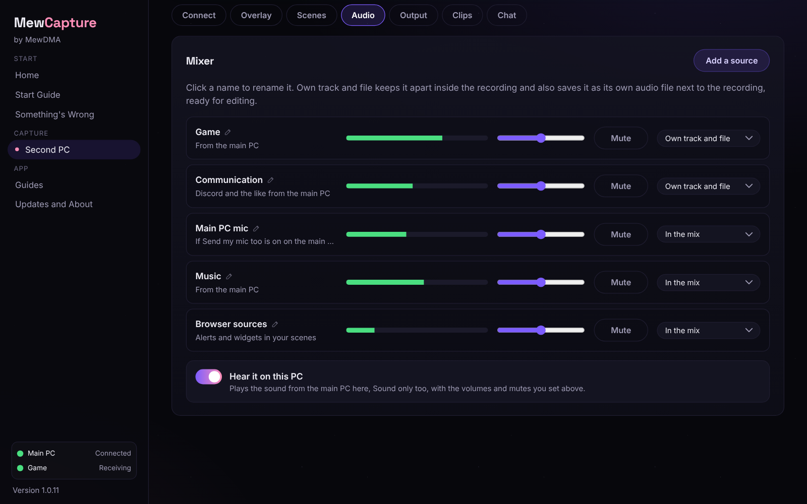</td>
</tr>
<tr>
<td width="50%" valign="top" align="center">Output presets 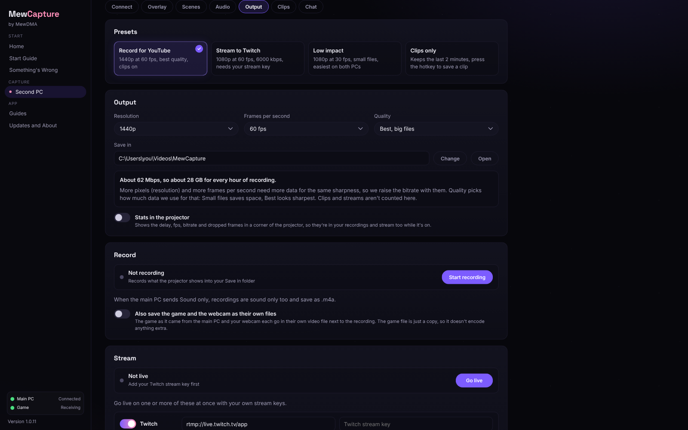</td>
<td width="50%" valign="top" align="center">Clip That 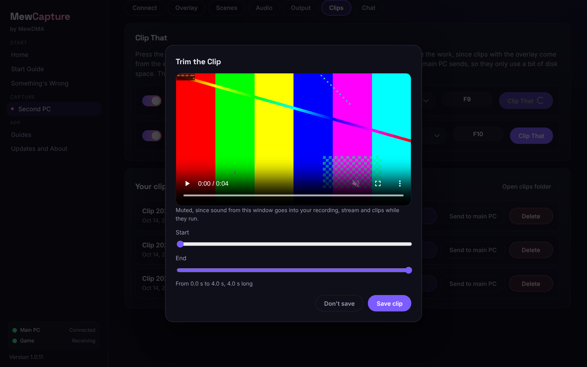</td>
</tr>
<tr>
<td width="50%" valign="top" align="center">Stream chat 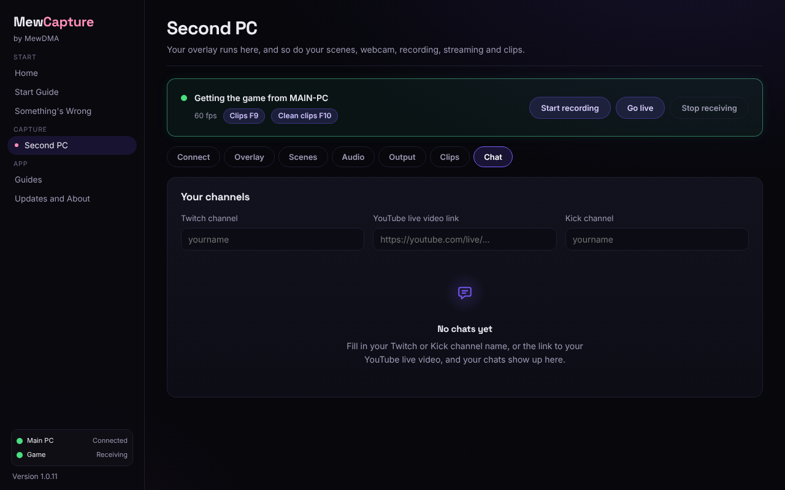</td>
<td width="50%" valign="top" align="center">Set up OBS for me 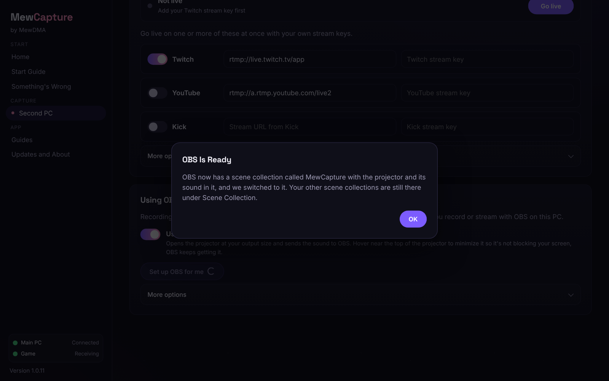</td>
</tr>
<tr>
<td width="50%" valign="top" align="center">Red safety warning 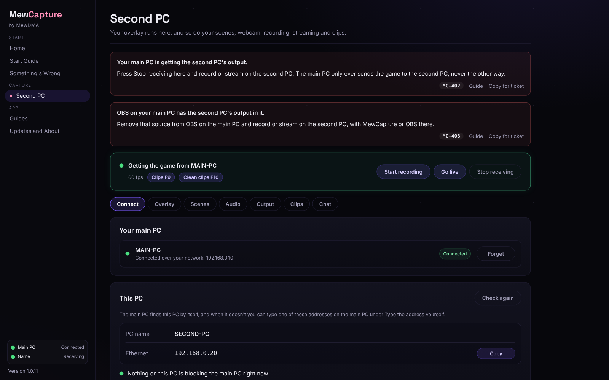</td>
<td width="50%" valign="top" align="center">Something's Wrong 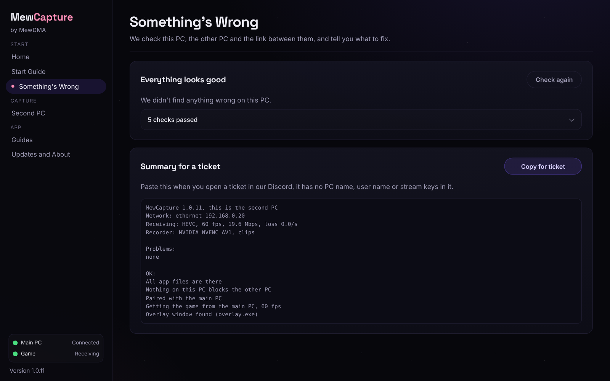</td>
</tr>
</table>

## What you need

| Part | What you need |
|---|---|
| PCs | Two PCs with Windows 10 or 11, 64 bit, your main PC and your second PC, with MewCapture on both |
| Main&nbsp;PC&nbsp;encoder | An NVIDIA, AMD or Intel graphics card, or Intel built-in graphics, for NVENC, AMF or QuickSync. The CPU encoder is the backup |
| Connection | Both PCs on the same router over Wi-Fi, Ethernet or both, or one Ethernet cable directly between them. A USB 3 to Ethernet adapter with 1 Gbps or more works if a PC has no spare port |
| Admin&nbsp;rights | On both PCs, so MewCapture can add the Windows Firewall rules the other PC needs to reach it |
| App&nbsp;sound | Sending the sound of single apps needs Windows 10 version 2004 or newer, and All PC sound works on any version |
| Optional | A webcam on the second PC, OBS, and stream keys for Twitch, YouTube or Kick |

### MewCapture at a glance

| | |
|---|---|
| Made&nbsp;by | [MewDMA](https://mewdma.net) |
| Price | Free, with no account needed |
| Runs&nbsp;on | Windows 10 and 11, 64 bit, on both PCs |
| Main&nbsp;PC&nbsp;sends | The whole screen, one window or just the sound, at 30, 60, 120 or 144 fps, as HEVC or H.264 at 12 to 50 Mbps |
| Encoders | NVIDIA NVENC, AMD AMF and Intel QuickSync, with the CPU (OpenH264) as the backup |
| Recording | MP4 at 720p, 1080p, 1440p or 4K and 30 to 144 fps, in AV1, HEVC or H.264 |
| Streaming | Twitch, YouTube and Kick, one or all of them at the same time |
| Clips | The last 30 seconds, 1 minute, 90 seconds or 2 minutes, with the overlay or clean |
| Network | UDP 47800 and 47801 and TCP 47802, only on your own network or a direct cable |
| Download | [MewDMA/MewCapture releases on GitHub](https://github.com/MewDMA/MewCapture/releases/latest) |

## Safety and anti-cheat

On the main PC, MewCapture only captures the screen or the game window with Windows Graphics Capture or DXGI desktop duplication, the same way Discord streaming does. It never injects into the game, never puts a DLL in it, never hooks it and never reads its memory, and for the keys and mouse display it only asks Windows which keys are held down, like any app can.

Your overlay only ever runs on the second PC, because anti-cheats take screenshots of the main PC and scan them, also with AI, for things like ESP. The projector, OBS, recording and streaming stay on the second PC too. MewCapture shows a red warning when its output or the projector runs on a PC with an anti-cheat (MC-402), or when OBS on your main PC has the projector, an NDI source or a stream from the second PC in its scenes (MC-403). OBS on the main PC on its own is fine.

Nobody can promise an app is undetectable, and everything can be detected eventually no matter what anyone says. That's why we kept MewCapture's part on the main PC as small as we could, so all it does there is capture the screen and send it to the second PC.

The two PCs only talk on your own network or the cable between them, and MewCapture only takes hotkeys, the keys and mouse display or clips from a PC you connected by pressing Connect on both PCs. Updates only come from our GitHub releases and each one is signed, so a changed or fake update won't install. Bug reports and the Something's Wrong summary never include your stream keys, PC name or Windows user name, and [docs/security.md](docs/security.md) explains all of it.

## MewCapture FAQ

<b>What is MewCapture?</b>

MewCapture is a free Windows app from [MewDMA](https://mewdma.net) for two-PC setups that records or streams your game with your overlay on it, without a capture card. The main PC sends the game and the sound you pick to the second PC, and the second PC adds your overlay, scenes and webcam and records, streams or saves clips.

<b>Is MewCapture free?</b>

Yes, MewCapture is free with no account needed, and you can download it from the [latest release](https://github.com/MewDMA/MewCapture/releases/latest) on GitHub.

<b>Do I need a capture card to record my DMA overlay?</b>

No, with MewCapture the main PC sends the game to the second PC over your own network or one Ethernet cable, and the second PC puts your overlay on it and records or streams.

<b>Do I need a DMA card or a MewDMA order to use MewCapture?</b>

No, MewCapture never touches your DMA card and works with any two Windows 10 or 11 PCs on the same router or a cable. You don't need to be a MewDMA customer to use it.

<b>Which PC do I install MewCapture on?</b>

Install it on both PCs. The main PC is the one you game on, and the second PC is the one your overlay runs on, where you record or stream. MewCapture asks which PC it is the first time it opens, and you can switch it later at the top of Updates and About.

<b>How do I pair my main PC and second PC in MewCapture?</b>

Press Start receiving on the second PC, then open the Main PC screen on the main PC, where your second PC shows up with a 4-digit code. When both PCs show the same code, press Connect on the second PC and then on the main PC, and from then on they connect by themselves as soon as both are open.

<b>Does MewCapture lower my FPS on the main PC?</b>

Very little, since the game goes directly from the screen into your graphics card's video encoder (NVENC, AMF or QuickSync) at low priority, and that's a separate part from the one that runs your game. The Main PC screen shows exactly how much CPU, video encoder and RAM MewCapture uses, and there's no preview on the main PC to keep it light.

<b>Can I run my overlay on the main PC with MewCapture?</b>

No, never. Anti-cheats take screenshots of the main PC and scan them, also with AI, for things like ESP, so your overlay only runs on the second PC, and MewCapture shows a red warning if the second PC's output comes back to the main PC.

<b>Is MewCapture undetectable?</b>

Nobody can promise that about any app, and everything can be detected eventually no matter what anyone says. What MewCapture does on the main PC is small, since it captures the screen with Windows' own screen capture like Discord streaming does and never injects into, hooks or reads the game.

<b>Does MewCapture inject into the game or read its memory?</b>

No, MewCapture never injects into the game, never puts a DLL in it, never hooks it and never reads its memory. On the main PC it only captures the screen or the game window with Windows Graphics Capture or DXGI desktop duplication, and [docs/security.md](docs/security.md) explains the rest.

<b>What's the best connection between the two PCs?</b>

One Ethernet cable directly between the two PCs, and any normal cable works with no special crossover one needed. If a PC has no spare port, a USB 3 to Ethernet adapter with 1 Gbps or more works, usually on the second PC. Next best is both PCs on the same router with cables, and Wi-Fi works too but drops show up as stutter. [Direct cable between two PCs](https://mewdma.net/guides/direct-cable-between-two-pcs) shows how.

<b>Can MewCapture stream to Twitch, YouTube and Kick at the same time?</b>

Yes, turn on each platform in Output, add its stream key and press Go live, and if a stream drops it connects again by itself while your recording and clips keep going. Fill in your channel names in the Chat tab and it shows the chat from all of them.

<b>Do I need OBS to use MewCapture?</b>

No, MewCapture records and streams by itself. If you like OBS, press Set up OBS for me in Output and OBS on the second PC gets a MewCapture scene collection with the projector and its sound, and your other scene collections stay as they are.

<b>How do I save a clip with Clip That?</b>

Press the clip hotkey on either PC, F9 by default or F10 for a clean clip without the overlay, and MewCapture saves the last 30 seconds to 2 minutes. Clips with the overlay are on from the start, and for clean ones you turn on Clean, game only in the Clips tab. You can trim the clip before you save it and send it to the main PC with Send to main PC.

<b>Where does MewCapture save my recordings, and can they get overwritten?</b>

Recordings go in Videos\MewCapture on the second PC and clips in the Clips folder inside it, and you can change the folder in Output. Recordings are never overwritten, and a setting you change while recording carries on in a new file.

<b>Can I record just the game sound with MewCapture?</b>

Yes, pick Sound only on the Main PC screen and tick the apps you want. The second PC shows Getting the sound and puts it in the mixer, and Start recording saves an .m4a with just the sound, or you can stream your scenes with that sound under them.

<b>Why is the game black in MewCapture?</b>

Pick Whole screen instead of One window on the main PC, since One window needs the game in borderless or windowed mode.

<b>Why do parts of my overlay disappear, or why is there a dark border?</b>

Drag How much gets removed in the Overlay tab. If your overlay lets you pick its background color, set it to pure green and press Detect again.

<b>Why does MewCapture stutter or look blocky?</b>

That's nearly always the network, so use a cable or pick Smooth as the quality on the main PC. MewCapture also lowers the quality by itself when packets get lost.

<b>Why can't my two PCs find each other?</b>

Press Start receiving on the second PC first and make sure both PCs are on the same router. A guest network, AP or client isolation in your router or a VPN can keep them apart, so use your main network, turn that setting off or let the VPN allow your local network (LAN). Something's Wrong on either PC shows what's blocking them, with a Fix it button for things like the firewall, and Type the address yourself or a [direct cable](https://mewdma.net/guides/direct-cable-between-two-pcs) gets them connected when nothing else helps.

<b>Why does Windows say "Windows protected your PC" when I install MewCapture?</b>

Windows SmartScreen shows that message because the MewCapture installer isn't code signed yet. Click More info and then Run anyway to install it, and if you want to check the file, its SHA-256 is in `SHA256SUMS.txt` on the release.

<b>How do MewCapture updates work?</b>

MewCapture checks the MewDMA/MewCapture releases on GitHub when it starts and once a day, and every update is signed by us and checked before it installs. Automatic updates is on by default, so a new version installs when the app starts, never in the middle of sending, a recording or a stream. If you turn it off in Updates and About, you get a bar with an Install and restart button instead. What changed in each version is in [CHANGELOG.md](CHANGELOG.md).

## Guides and support

> [!TIP]
> If you get stuck, open Something's Wrong in MewCapture, click Copy for ticket and open a ticket in our [Discord](https://discord.gg/mewdma), then paste the summary in.

The MewCapture page is [mewdma.net/capture](https://mewdma.net/capture), all our guides are at [mewdma.net/learn](https://mewdma.net/learn), and the MewCapture guide is in the app under Guides too. Every error in the app has a short MC code with the cause and the fix, and you can send us a bug or an idea with Report a bug or idea in the app. What changed in each version is in [CHANGELOG.md](CHANGELOG.md).

Step by step guides with pictures:

- [How to set up MewCapture on both PCs](https://mewdma.net/guides/set-up-mewcapture)
- [Direct cable between two PCs](https://mewdma.net/guides/direct-cable-between-two-pcs)
- [How MewCapture works, and what runs on each PC](https://mewdma.net/blog/mewcapture)
- [The MewCapture guide, the same steps as in the app](docs/guide.md)
- [Using OBS on the second PC](docs/guide.md#using-obs-on-the-second-pc)
- [When the PCs can't find each other](docs/guide.md#when-the-pcs-cant-find-each-other)

How MewCapture handles security: [docs/security.md](docs/security.md).
