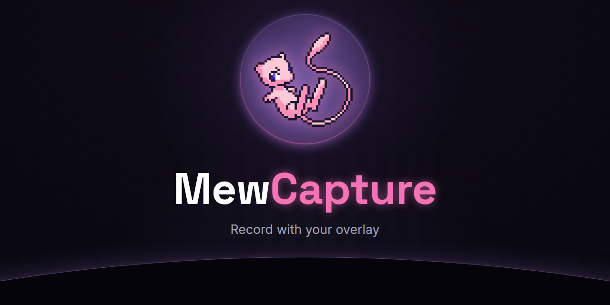

**Free Windows app to record or stream your game with your overlay on it, no capture card needed.** 
Made by <a href="https://mewdma.net">MewDMA</a> for DMA setups with a main PC and a second PC.

---

## What it does

<table>
<tr>
<td width="50%" valign="top">

**No capture card** 
The main PC sends the game to the second PC over your network or one Ethernet cable, up to 4K or 144 fps

</td>
<td width="50%" valign="top">

**Barely costs fps** 
The game goes directly from the screen into your graphics card's video encoder at low priority, and the app shows you how little it uses

</td>
</tr>
<tr>
<td valign="top">

**Your overlay, safely** 
Your overlay only ever runs on the second PC and we remove its background for you. If the second PC's output comes back to the main PC, like the projector or OBS with the overlay in it, you get a red warning

</td>
<td valign="top">

**Never touches the game** 
It captures the screen the same way Discord streaming does and never hooks the game, puts a DLL in it or reads its memory

</td>
</tr>
<tr>
<td valign="top">

**Scenes like OBS, but simple** 
Add the game, your overlay, your webcam with background blur, images, text, countdowns, browser sources or your keys and mouse, with studio mode and smooth transitions

</td>
<td valign="top">

**Clip That** 
One hotkey on either PC saves the last 30 seconds to 2 minutes with the overlay or clean, and you can trim it and send it to the main PC

</td>
</tr>
<tr>
<td valign="top">

**Record and stream** 
Pick a preset for YouTube, Twitch, Low impact or Clips only, and go live on Twitch, YouTube and Kick at the same time with the chat right in the app

</td>
<td valign="top">

**Mixer** 
Meters, mute and push to talk, with the game, your mic and Discord on their own tracks in recordings

</td>
</tr>
<tr>
<td valign="top">

**Pairs by itself** 
Check that both PCs show the same code the first time, after that they find each other and reconnect on their own over Wi-Fi, Ethernet or a cable

</td>
<td valign="top">

**Something's wrong button** 
Checks both PCs and the connection, tells you what's off and how to fix it and makes a summary you can paste in a ticket

</td>
</tr>
</table>

## Install

1. Download the installer from <a href="https://github.com/MewDMA/MewCapture/releases/latest">releases</a> and install it on **both** PCs
2. Run it. Windows might say "Windows protected your PC", click More info then Run anyway. That's just because the app isn't code signed yet
3. Open MewCapture, it asks for admin so it can open the firewall for the other PC. Your overlay, recording and streaming only go on the second PC, never on the main PC

---

**Need help?** Check the <a href="https://mewdma.net/guides">guides</a>, ask on the <a href="https://mewdma.net/forum">forum</a> or open a ticket in our <a href="https://discord.gg/mewdma">Discord</a>.

<!-- mewcapture-guides -->
## Guides

Our step by step guides with pictures are on mewdma.net and in the app under Guides.

- [Getting started with MewCapture](https://mewdma.net/guides/getting-started-with-mewcapture)
- [The overlay safety rule](https://mewdma.net/guides/getting-started-with-mewcapture#safety)
- [Direct cable and USB to Ethernet adapters](https://mewdma.net/guides/getting-started-with-mewcapture#direct)
- [Using OBS on the second PC](https://mewdma.net/guides/getting-started-with-mewcapture#obs)
- [When the PCs can't find each other](https://mewdma.net/guides/getting-started-with-mewcapture#network)

How MewCapture handles security: [docs/security.md](docs/security.md).
