# MewCapture guide

Made from `app/src/guide-data.ts`, the same steps and pictures as the Guide screen in the app. Edit that file, then run `node scripts/guide-md.mjs` in `app/`.

> **Your main PC is never the recording or streaming PC. Anti-cheats take screenshots of the main PC and scan them, also with AI, for things like ESP, so the overlay only ever runs on the second PC. Record, stream and use the projector or OBS there too, and never send the overlay or MewCapture's output back to the main PC to put your game under it. MewCapture warns you in red if it sees that.**

## Step by step

### Step 1: Install MewCapture (both PCs)

Download MewCapture-Setup from the MewCapture releases page and install it on both PCs, then open it and pick which PC it is. Start guide on Home walks you through the rest and picks good settings for you.

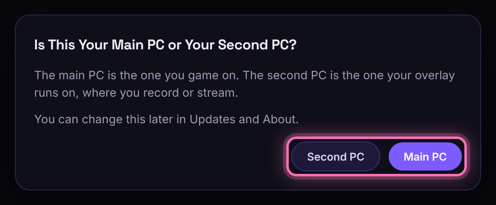

### Step 2: Press Start (second PC)

Press Start receiving on the Second PC screen and this PC waits for the main PC.

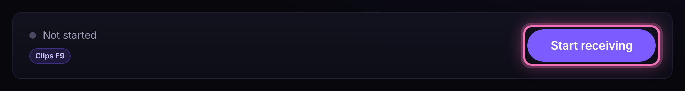

### Step 3: Pick your overlay window (second PC)

Open your overlay on this PC and press Pick your overlay window on the Second PC screen. It works before and after Start. We find its background (usually black) and how much to remove for you, and the preview shows how it looks over the game with the slider under it if you want to change it.

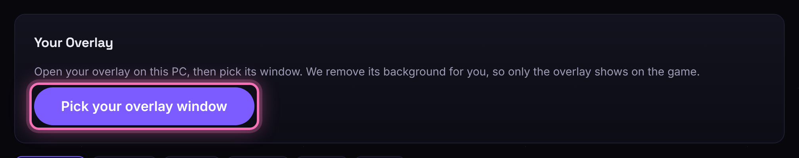

### Step 4: Find the Second PC (main PC)

Your second PC shows up on the Main PC screen with a 4-digit code. Both PCs have to be on the same router (Wi-Fi, Ethernet or both is fine, not a guest network), or joined with one direct cable.

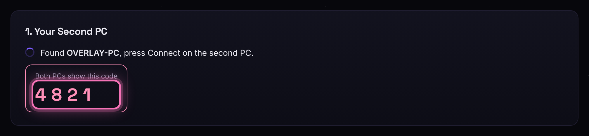

### Step 5: Connect (second PC)

The second PC shows Found with the main PC's name. Check it shows the same code and press Connect. Next time the second PC shows the main PC as Connected as soon as both are open.

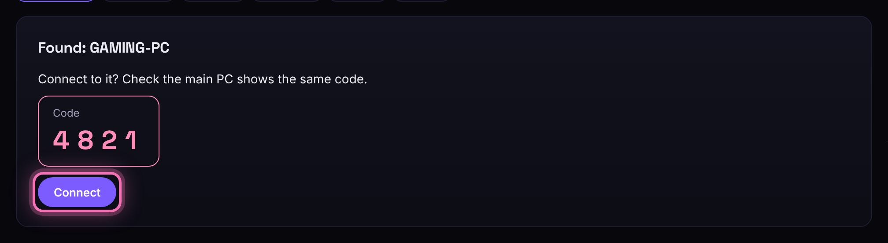

### Step 6: Pick what to send and press Start (main PC)

Pick Whole screen and which screen (works with every game), One window and your game's window, or Sound only to send just the sound with no picture. Tick the apps you want to hear like the game and Discord, and press Start sending. You can also press Start sending on the main PC from the second PC while MewCapture is open on both.

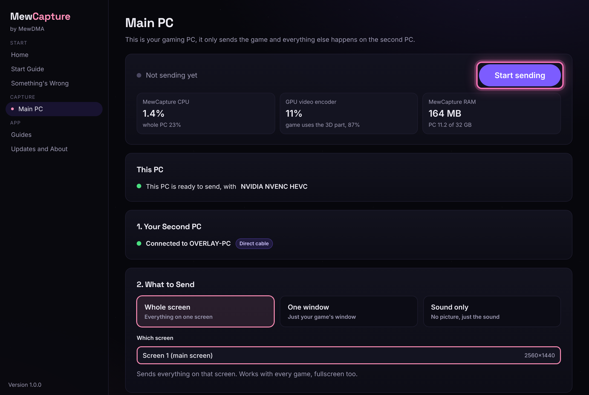

### Step 7: That's all on the main PC (main PC)

MewCapture shows how little it uses while it sends. You can close it, it keeps running in the tray, or press Small window. We left out a preview on the main PC on purpose so it stays light.

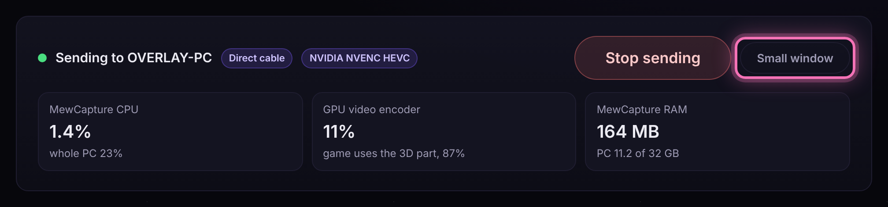

### Step 8: Set up your scenes (second PC)

Add your webcam (you can blur or remove its background), images, text, a countdown, a browser source for alerts or your keys and mouse. Drag things to move them and they snap to the guides, arrow keys move them a bit and Ctrl+Z undoes, right-click for more.

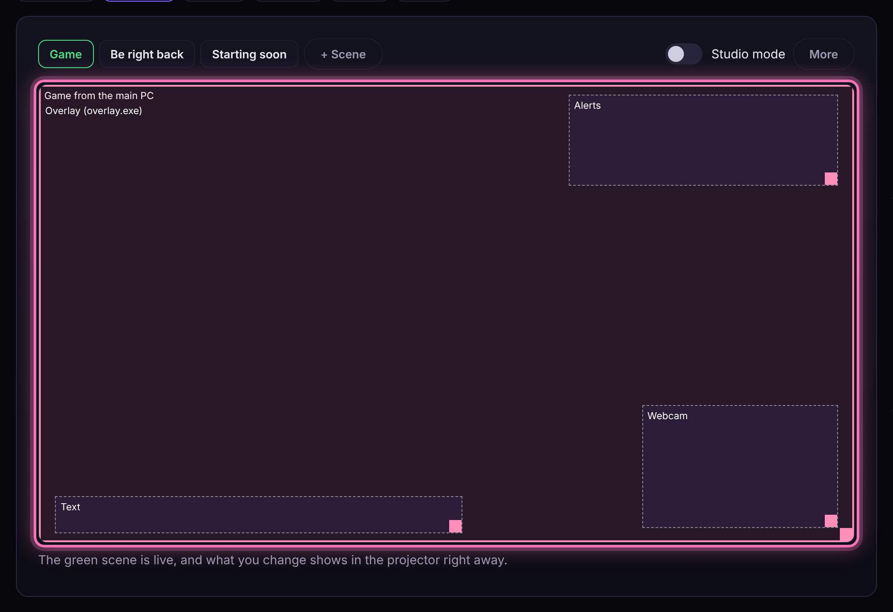

### Step 9: Set the sound (second PC)

In Audio you set each volume with the meters, mute what you don't want and rename anything. Own track and file keeps a source apart in the recording and also saves it as its own audio file, ready for editing. Add a source adds the sound of any app on this PC, Listen to the recording lets you hear what the recording gets, and the mic comes from the main PC with Send my mic too.

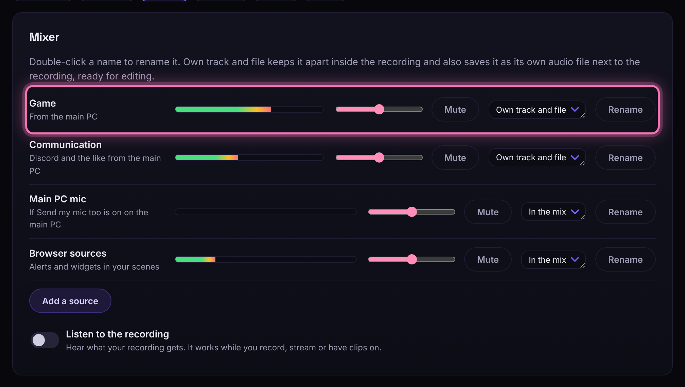

### Step 10: Pick a preset and go (second PC)

In Output pick a preset, then press Record or Go live. You can go live on Twitch, YouTube and Kick at the same time, or press Set up OBS for me if you'd rather use OBS.

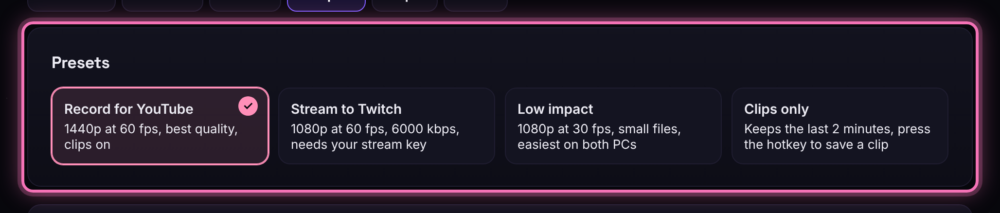

### Step 11: Clip That (both PCs)

Press the clip hotkey on either PC to save the last 30 seconds to 2 minutes, with the overlay or clean (just the game, to show friends). You can trim it and send a clean clip to the main PC in one click.

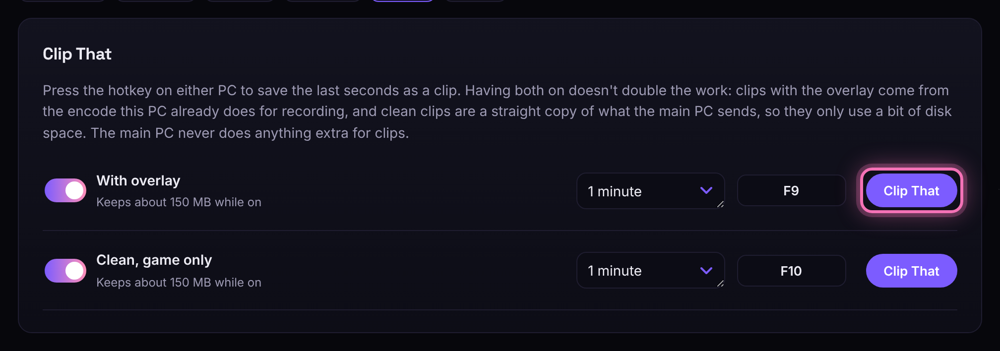

## The main PC only plays and sends the game

Your main PC is never the recording or streaming PC. Anti-cheats take screenshots of the main PC and scan them, also with AI, for things like ESP, so the overlay only ever runs on the second PC. Record, stream and use the projector or OBS there too, and never send the overlay or MewCapture's output back to the main PC to put your game under it. MewCapture warns you in red if it sees that.

MewCapture only captures the screen the same way Discord streaming does, with Windows Graphics Capture or DXGI desktop duplication. It never injects into or hooks the game, never puts a DLL in it and never reads its memory, which is also why there's no OBS style game capture hook.

The main PC only sends the game, and everything else like scenes, the overlay, your webcam, clips, recording and streaming happens on the second PC.

Some people try to save the second PC some work by sending the overlay back to the main PC, or by running the projector or OBS on the main PC and putting the game under the overlay there. That puts your overlay on the main PC's screen, right where anti-cheats look.

So MewCapture shows a red warning when its output or the projector runs on a PC with an anti-cheat, or when OBS on your main PC has the MewCapture projector, an NDI source or a stream from the second PC in its scenes. OBS on the main PC on its own is fine, the warning is only for the second PC's output coming back.

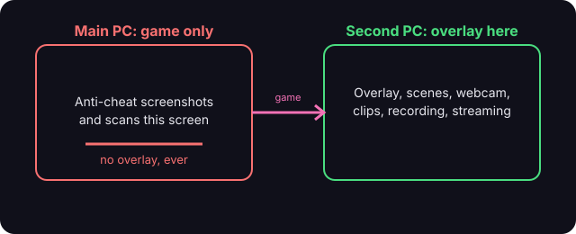

## Direct cable, the lightest setup

For the least delay and the least work for the main PC, plug a normal Ethernet cable from the main PC directly into the second PC. Any Ethernet cable works fine, no need for a special crossover one.

After about a minute Windows gives both ends an address that starts with 169.254. MewCapture finds the second PC over that cable and uses it, and shows Direct cable when it does. Your internet keeps going through your other network port or Wi-Fi.

If a PC has no spare Ethernet port, a USB to Ethernet adapter works fine. Plug it into the PC that needs the extra port, usually the second PC since the main PC's own port is often already used for the internet, and get a USB 3 one with 1 Gbps or more.

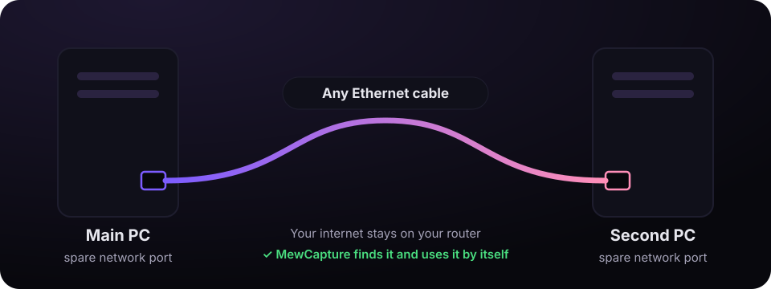

## Using OBS on the second PC

The easiest way is to press Set up OBS for me in Output, then pick Scene Collection and MewCapture in OBS. It already has the projector and its sound in it.

To do it yourself, turn on Using OBS? Open the projector window in Output, then add a Window Capture in OBS and pick [MewCapture.exe]: MewCapture Projector. The projector always opens fullscreen. Hover near the top to minimize it so it's not blocking your screen, OBS keeps getting it. You only need the projector for OBS, MewCapture's own recording, streaming and Clip That work without it.

For the sound, turn on Send the sound to OBS in Output, then add a Media Source in OBS, untick Local File and put udp://127.0.0.1:47811 as the input. Set up OBS for me adds it for you. Turn off Also play the sound on this PC's speakers if you only want it in OBS.

Add your browser sources in OBS like you normally would. The main PC mic comes with the sound when Send my mic too is on there.

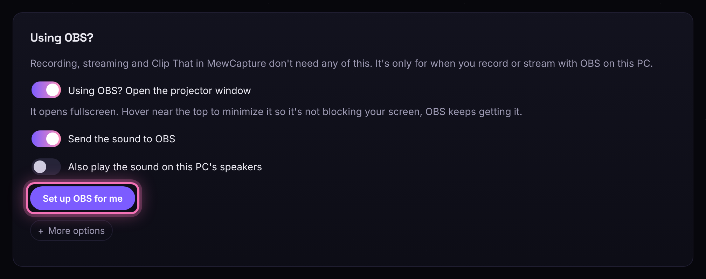

## When the PCs can't find each other

Press Start on the second PC first and make sure both PCs are on the same router. Wi-Fi, Ethernet or a mix works fine, mesh Wi-Fi too.

A guest network, or a router setting called AP isolation or client isolation, keeps devices apart. Put both PCs on the main network, or turn that setting off in your router.

A VPN can hide your home network. Turn it off, or allow the local network (LAN) in its settings.

On the second PC, Connect and then Network shows what might be blocking it, with a Fix it button when we can fix it for you. If nothing helps, use a cable between the two PCs.

Use Ethernet for the main PC if you can. Wi-Fi works but drops show up as stutter, and we lower the quality when that happens.

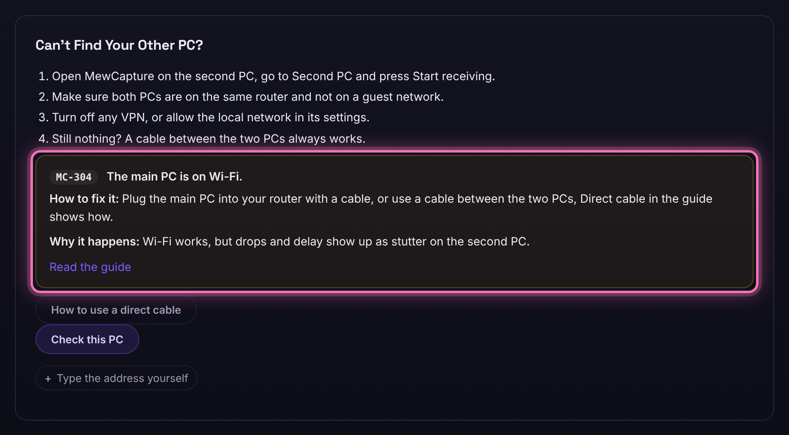

## Questions

**Can I send just the sound?** 
Yes. Pick Sound only under What to Send on the main PC and tick the apps you want. The second PC shows Getting the sound and puts it in the mixer like always. Record it on its own with Sound only, no picture in Output (that saves an .m4a), or stream your scenes with that sound under them.

**What can the hotkeys do?** 
Clip That (with the overlay or clean), switching scenes and showing or hiding the projector. Click a hotkey box and press the keys you want, they work on both PCs so you can clip while you play.

**Can I run my overlay on the main PC?** 
No, never. Anti-cheats screenshot the main PC and scan it, also with AI, for things like ESP, so the overlay only runs on the second PC.

**Do I need a capture card?** 
No, the main PC sends the game over your network or a cable and the second PC puts your overlay and scenes on top.

**Does it cost fps on the main PC?** 
Very little, it goes directly from the screen into your graphics card's video encoder (NVENC, AMF or QuickSync), which is a separate part from the one that runs your game, and it runs at low priority. The Main PC screen shows exactly how much it uses.

**Is it safe with anti-cheat?** 
MewCapture only captures the screen like Discord streaming does. It never injects into or hooks the game, never puts a DLL in it and never reads its memory. Your overlay must never be shown on the main PC.

**What's the best connection?** 
A direct Ethernet cable between the two PCs. If a PC has no spare port, a USB to Ethernet adapter works, usually on the second PC. Next best is both PCs on the router with cables.

**The game is black or nothing shows** 
Use Whole screen instead of One window, since One window needs the game in borderless or windowed mode.

**Parts of my overlay disappear, or there's a dark border** 
Drag How much gets removed. If your overlay lets you pick its background color, set it to pure green and press Detect again.

**It stutters or has blocky bits** 
That's the network, so use a cable or pick Smooth as the quality on the main PC. MewCapture also lowers the quality for you when packets get lost.

**How do I get it in OBS?** 
Press Set up OBS for me in Output. If OBS is closed we add a scene collection called MewCapture you pick under Scene Collection. If OBS is open with its WebSocket on, we add it straight away, unless you're live or recording. With the WebSocket off you restart OBS once. We never change your other scene collections, and if OBS isn't installed we link you to obsproject.com instead of installing it.
